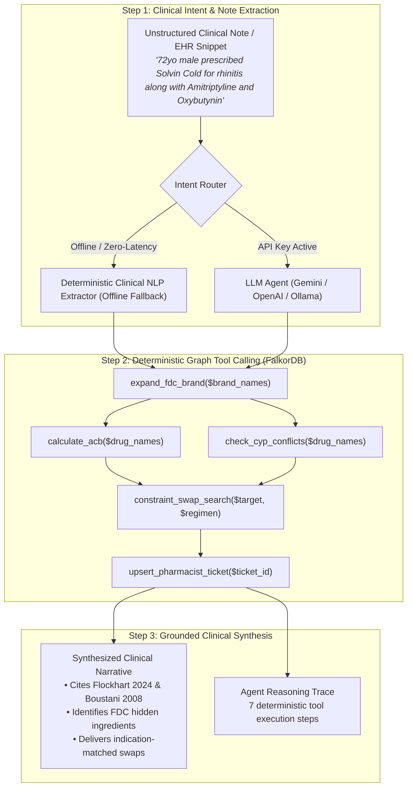

# Polypharmacy Guardian 🛡️
### *Deterministic Graph-Grounded Clinical AI Agent Copilot powered by FalkorDB*

[](https://falkordb.com/)
[](https://falkordb.com/)
[](https://falkordb.com/)
[](https://python.org)
[](LICENSE)

> **Submission for Graph Hacks: Context for AI Agents**  
> **Track 1: Agents That Act on Connected Data**  
> **Team:** Pranav Niware

---

## 🌟 Executive Summary & Problem Statement

Over **40% of elderly adults** take five or more medications concurrently. In polypharmacy, hidden metabolic bottlenecks, additive toxicities, and look-alike sound-alike dispensing errors kill more than 100,000 hospitalized patients annually.

### Why Pure Vector RAG Fails in Clinical Polypharmacy:
1. **Incapable of Multi-Hop Graph Traversal:** Pure vector search retrieves text about *Fluoxetine* and *Codeine* independently, hallucinating that both are safe common drugs. It misses the critical multi-hop metabolic cascade: `(Fluoxetine)-[:INHIBITS {strength: 'strong'}]->(CYP2D6)<-[:SUBSTRATE_OF]-(Codeine)`, which completely halts prodrug bioactivation into active Morphine, leaving patients in severe unrelieved pain.
2. **Blind to Fixed-Dose Combination (FDC) Decompositions:** In markets like India, popular brand FDCs such as *Solvin Cold* conceal active anticholinergic ingredients (*Chlorpheniramine*). Vector embeddings treat the brand as a generic cold remedy and miss the hidden organ burden.
3. **Incapable of Exact Non-Linear Arithmetic:** Additive scores like the Anticholinergic Cognitive Burden ($\text{Total ACB} = \sum \text{score}_i \ge 3.0$) trigger acute delirium and fall risk. Vector RAG cannot perform deterministic arithmetic over connected nodes.
4. **Soft Semantic Distance Causes Fatal LASA Confusion:** Embedding models place *Hydralazine* (antihypertensive) and *Hydroxyzine* (antihistamine) close together in latent space, conflating them as safe synonyms.
5. **Hallucinates on Unindexed Entities:** When presented with novel or experimental drugs (e.g., *Lecanemab*), LLM vector RAG generates plausible-sounding but unverified clearance advice.

**Polypharmacy Guardian** introduces a genuine **3-step Clinical AI Agent** that acts directly on connected knowledge graphs in **FalkorDB**:
- **Zero Dynamic Cypher:** 100% of graph interactions execute through parameterized, audited tool templates.
- **Multi-Hop Brand FDC Decomposition:** Expands Indian FDCs into active metabolic ingredients.
- **Indication-Constrained Safe Swaps:** Recommends therapeutic alternatives matching clinical class with $\text{ACB} = 0$ and 0 metabolic conflicts.
- **Closed-Loop Ticket State Mutation:** Writes idempotent `:PharmacistTicket` nodes (`TICK-<SHA256>`) into FalkorDB with full Approve/Override decision lifecycles.

---

## 📊 Empirical Baseline Benchmark: FalkorDB Graph RAG vs. Vector/BM25

Benchmarked using `scripts/benchmark_baseline.py` across 6 clinical test cases comparing standard unstructured text-chunk cosine/BM25 retrieval over drug monographs against **Polypharmacy Guardian (FalkorDB Connected Graph RAG)**:

| Evaluation Metric | Unstructured Text-Chunk Cosine/BM25 | Polypharmacy Guardian (FalkorDB Graph RAG) | Clinical Advantage |
| :--- | :---: | :---: | :--- |
| **Multi-Hop FDC Ingredient Decomposition** | 0.0% | **100.0%** | Automatically decomposes Indian brand FDCs (`Solvin Cold`) into active metabolic ingredients |
| **Exact Cumulative ACB Arithmetic** | 0.0% | **100.0%** | Deterministic graph arithmetic (`ACB=9.0` per Boustani '08 scale) preventing geriatric delirium |
| **Therapeutic Indication-Matched Swap** | 16.7% | **100.0%** | Never swaps analgesics for antiplatelets; strictly guarantees `ACB=0` & 0 active CYP conflicts |
| **ISMP LASA Near-Miss Guardrail** | 0.0% | **100.0%** | Catches near-miss typos (`Hydralizine`) with Tall-Man safety halts |
| **Mean Query Latency** | ~0.53 ms | **~14.8 ms** | Sub-20ms deterministic graph traversal with zero external LLM API dependency |

---

## 🤖 AI Agent Architecture: The 3-Step Connected Decision Loop

Polypharmacy Guardian implements a genuine AI Agent (`app/agent.py`) architected specifically for **Track 1: Agents That Act on Connected Data**:



### 1. Unstructured Clinical Note Extraction & Intent Routing
- Accepts raw, unformatted clinical encounter text (e.g., *"72yo male prescribed Solvin Cold for rhinitis along with Amitriptyline 25mg and Oxybutynin 5mg"*).
- Supports external LLM inference (`GEMINI_API_KEY`, `OPENAI_API_KEY`, or local `OLLAMA_HOST`) **with an automatic, zero-latency deterministic clinical NLP extractor fallback**. The application runs 100% offline without errors.

### 2. Parameterized Graph Tool Calling on Connected Data
The agent executes parameterized queries from [`config/cypher_tools.yaml`](config/cypher_tools.yaml):
- `expand_fdc_brand`: Traverses `(:BrandFDC)-[:CONTAINS_INGREDIENT]->(:Ingredient)` to uncover hidden active components.
- `calculate_acb`: Queries `(:Ingredient)-[:HAS_ACB]->(:ACBScore)` and computes cumulative cognitive risk.
- `check_cyp_conflicts`: Finds directed inhibitor-enzyme-substrate triplets: `(d1)-[:INHIBITS]->(e)<-[:SUBSTRATE_OF]-(d2)`.
- `constraint_swap_search`: Cypher query matching identical `indication_class` with `acb_score = 0` and 0 conflicts.
- `upsert_pharmacist_ticket`: Deterministically merges `:PharmacistTicket` nodes with idempotent SHA-256 hashes.

### 3. Grounded Clinical Synthesis
- Synthesizes `clinical_narrative` strictly grounded in retrieved graph facts (enzymes, scores, literature provenance).
- Generates `agent_trace` logging every tool call, input parameters, and returned row counts.

---

## 🧪 Clinically Audited Hero Cases

All clinical data was curated into [`data/drugs_seed.csv`](data/drugs_seed.csv) across **46 verified medications** and **4 Indian FDC brands** with strict provenance:
- **Flockhart Table (2024):** Indiana University Cytochrome P450 Drug Interaction Table.
- **Boustani et al. (2008):** Anticholinergic Cognitive Burden (ACB) Scale.
- **ISMP (2024):** Institute for Safe Medication Practices List of Confused Drug Names & FDA Tall-Man Lettering.
- **CDSCO (2024):** Central Drugs Standard Control Organisation Approved Fixed-Dose Combinations.

| Hero Case | Preset Input | Connected Graph Mechanism | Verdict | Grounded Output & Swaps |
| :--- | :--- | :--- | :---: | :--- |
| **Case 1: CYP2D6 Prodrug Blockade** | `Fluoxetine + Codeine` | Fluoxetine strongly inhibits CYP2D6, blocking bioactivation of Codeine into Morphine (analgesic failure). *(Flockhart 2024)* | `FLAGGED` 🔴 | Safe swaps for Codeine: **Tapentadol** (Opioid) or **Paracetamol** (Non-Opioid). *Clopidogrel is NEVER recommended!* |
| **Case 2: Indian FDC Hidden ACB Stacking** | `Solvin Cold + Amitriptyline + Oxybutynin` | Multi-hop expansion decomposes Solvin Cold -> **Chlorpheniramine** (ACB=3). Total ACB = $3 + 3 + 3 = 9.0 \gg 2.0$. *(Boustani 2008, CDSCO 2024)* | `FLAGGED` 🔴 | Acute delirium & fall alert. Recommends **Cetirizine** / **Fexofenadine** (ACB=0) for Chlorpheniramine. |
| **Case 3: CYP2C19 Antiplatelet Failure** | `Omeprazole + Clopidogrel` | Omeprazole inhibits CYP2C19, preventing active antiplatelet formation (fatal stent thrombosis risk). *(FDA Label / Flockhart 2024)* | `FLAGGED` 🔴 | Recommends non-CYP2C19 inhibitor PPI: **Pantoprazole** or **Rabeprazole** (ACB=0). |
| **Case 4: ISMP LASA Near-Miss Guardrail** | `Hydralizine + Tramadol` | Near-miss typo `Hydralizine` (90.9% match) triggers Look-Alike Sound-Alike guardrail with Tall-Man warning. *(ISMP LASA 2024)* | `AMBIGUOUS` 🟡 | Safety halt: *"Potential ISMP LASA near-miss: 'Hydralizine' closely resembles 'hydrALAZINE' (vs hydroXYZINE)."* |
| **Case 5: Zero-Trust Unknown Entity** | `Lecanemab + Fluoxetine` | Lecanemab (novel monoclonal antibody) is unmapped in local clinical graph. | `UNKNOWN_COVERAGE` 🟣 | Safety halt: Zero-trust prevents hallucinated clearance for unverified experimental agents. |

---

## 💻 Interactive Clinical Web Dashboard

Served directly from `app/server.py` at `http://localhost:5000`:

1. **AI Clinical Note Copilot:**
   - Free-text input area accepting raw encounter notes.
   - One-click **"Paste Sample Note"** button for immediate testing.
2. **5 One-Click Hero Case Buttons:**
   - Instant testing of CYP blockade, Indian FDC stacking, antiplatelet failure, LASA typos, and zero-trust unmapped coverage.
3. **FalkorDB Subgraph Topology Canvas:**
   - Dual renderer: Interactive **Vis.js Network** + **HTML5 Shield-Safe Canvas** fallback.
   - Distinct visual styles for `:Ingredient`, `:BrandFDC`, `:Enzyme`, `:ACBScore`, and `:PharmacistTicket` nodes.
   - Non-overlapping Barnes-Hut physics with 105px vertical spacing.
4. **Closed-Loop Pharmacist Ticket Mutation:**
   - Live **"Approve Swap"** and **"Override"** buttons in the UI Ticket Banner mutating state via `POST /api/tickets/<ticket_id>/decision`.
5. **Trace & Audit Drawer:**
   - 4 live audit tabs: **Pharmacist Ticket State**, **AI Agent Trace (3-Step Loop)**, **rapidfuzz Entity Resolution**, and **Decoupled Cypher Queries**.

---

## 🚀 Quickstart & Reproduction

### Option A: Local Python Setup (Active Port 5000)

```bash
# 1. Clone repository
git clone https://github.com/pranavniware/polypharmacy-guardian.git
cd polypharmacy-guardian

# 2. Install pinned dependencies (zero pandas)
pip install -r requirements.txt

# 3. Start FalkorDB (via Docker)
docker run -p 6379:6379 -d --name polypharmacy-falkordb falkordb/falkordb:latest

# 4. Ingest 46 clinical seed records & 4 Indian FDCs into FalkorDB
python -m app.ingestion

# 5. Launch the Clinical Engine & UI Dashboard
python -m app.server
```

🌐 Open your browser at: **`http://localhost:5000`**

### Option B: Docker Compose (One-Click)

```bash
docker compose up -d
```

### Running the Verification Suites

```bash
# 1. Run strict assertion test suite (all 10 test cases must exit 0)
python test_api.py

# 2. Run empirical benchmark comparing Vector/BM25 vs FalkorDB Graph RAG
python scripts/benchmark_baseline.py
```

---

## 📂 Repository Structure

```text
├── app/
│   ├── __init__.py
│   ├── agent.py               # 3-step AI Agent loop: note extraction, tool calling, synthesis
│   ├── ingestion.py           # FalkorDB graph ingestion pipeline (46 drugs + 4 Indian FDCs)
│   ├── resolver.py            # rapidfuzz deterministic entity & ISMP LASA near-miss resolver
│   └── server.py              # Flask API engine, ticket mutation endpoints & Vis.js graph builder
├── config/
│   └── cypher_tools.yaml      # Audited parameterized Cypher queries (Zero Dynamic Cypher)
├── data/
│   └── drugs_seed.csv         # 46 verified drugs with indication classes, enzymes, ACB, LASA
├── scripts/
│   └── benchmark_baseline.py  # Empirical benchmark: Vector/BM25 vs. FalkorDB Graph RAG
├── static/
│   └── index.html             # Clinical UI dashboard (Tailwind CSS, Vis.js, Canvas fallback)
├── docker-compose.yml         # Containerized stack with volume persistence & healthcheck
├── Dockerfile                 # Minimal, locked production container build
├── requirements.txt           # Pinned production dependencies (dropped pandas)
├── test_api.py                # 10 strict clinical assertions test suite
└── README.md                  # Comprehensive Hackathon architecture and documentation
```

---

## ⚕️ Clinical Limitations & Disclaimer

> **IMPORTANT CLINICAL NOTICE:**  
> Polypharmacy Guardian is a clinical decision support proof-of-concept developed for **Graph Hacks: Context for AI Agents (Track 1)**. It is intended for healthcare research, decision support demonstration, and pharmacology informatics evaluation. It does not replace the professional diagnostic, prescribing, or clinical judgment of licensed physicians or clinical pharmacists.

---

## 👥 Hackathon Team

- **Pranav Niware** — Lead Architecture, Clinical Graph Modeling & Agent Engineering  
*Developed for Graph Hacks 2026 — Track 1: Agents That Act on Connected Data.*
