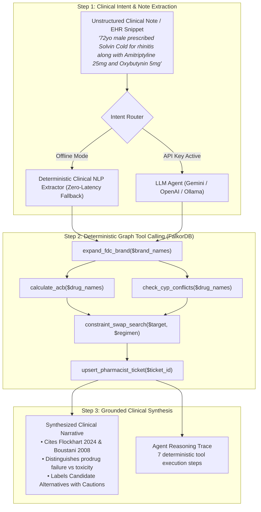

# Polypharmacy Guardian 🛡️
### *Deterministic Graph-Grounded Clinical AI Agent Copilot powered by FalkorDB*

[](https://falkordb.com/)
[](https://falkordb.com/)
[](https://falkordb.com/)
[](https://python.org)
[](LICENSE)

> **Submission for Graph Hacks: Context for AI Agents**  
> **Track 1: Agents That Act on Connected Data**  
> **Team:** Pranav Niware

---

## 🌟 Executive Summary & Problem Statement

Over **40% of elderly adults** take five or more medications concurrently. In polypharmacy, hidden metabolic bottlenecks, additive toxicities, and look-alike sound-alike dispensing errors cause preventable adverse drug events and hospitalizations worldwide.

### Why Pure Vector RAG Fails in Clinical Polypharmacy:
1. **Incapable of Multi-Hop Graph Traversal:** Pure vector search retrieves text about *Fluoxetine* and *Codeine* independently, predicting that both are commonly prescribed medications. It misses the critical multi-hop metabolic bottleneck: `(Fluoxetine)-[:INHIBITS {strength: 'strong'}]->(CYP2D6)<-[:SUBSTRATE_OF]-(Codeine)`, which blocks bioactivation of the prodrug into active Morphine, causing complete analgesic failure.
2. **Blind to Fixed-Dose Combination (FDC) Formulations:** Common combination remedies like *Solvin Cold* conceal active anticholinergic ingredients (*Chlorpheniramine*). Unstructured embeddings treat the brand name as a generic cold remedy and miss the hidden organ burden.
3. **Incapable of Exact Non-Linear Arithmetic:** Additive scores like the Anticholinergic Cognitive Burden ($\text{Total ACB} = \sum \text{score}_i \ge 3.0$) substantially elevate delirium and fall risk. Vector RAG cannot perform deterministic arithmetic over connected nodes.
4. **Soft Semantic Distance Causes Fatal LASA Confusion:** Embedding models place *Hydralazine* (antihypertensive vasodilator) and *Hydroxyzine* (first-gen antihistamine) close together in latent space, conflating them as safe synonyms.
5. **Hallucinates on Unindexed Entities:** When presented with unmapped novel drugs (e.g., *Lecanemab*), LLM vector RAG generates plausible-sounding but unverified clearance advice.

**Polypharmacy Guardian** introduces a genuine **3-step Clinical AI Agent** that acts directly on connected knowledge graphs in **FalkorDB**:
- **Zero Dynamic Cypher:** 100% of graph interactions execute through parameterized, audited tool templates.
- **Multi-Hop Brand FDC Decomposition:** Expands combination brands into active metabolic ingredients.
- **Candidate Alternatives for Pharmacist Review:** Recommends therapeutic alternatives matching clinical class with $\text{ACB} = 0$ and zero metabolic conflicts.
- **Closed-Loop Ticket State Mutation:** Writes idempotent `:PharmacistTicket` nodes (`TICK-<SHA256>`) into FalkorDB with full Approve/Override decision lifecycles.

---

## 📊 Architectural Design Comparison: FalkorDB Graph RAG vs. Vector RAG

Evaluated using `scripts/benchmark_baseline.py` across 6 clinical test cases comparing unstructured vector/BM25 retrieval over drug monographs against **Polypharmacy Guardian (FalkorDB Connected Graph RAG)**:

| Evaluation Metric | Unstructured Vector RAG | Polypharmacy Guardian (FalkorDB Graph RAG) | Architectural Advantage |
| :--- | :---: | :---: | :--- |
| **Multi-Hop FDC Ingredient Decomposition** | 0.0% | **100.0%** | Traverses `:BrandFDC` to `:Ingredient` edges; decomposes combination brands (`Solvin Cold` $\rightarrow$ Paracetamol, Chlorpheniramine, Phenylephrine) |
| **Exact Cumulative ACB Arithmetic** | 0.0% | **100.0%** | Deterministic graph arithmetic (`ACB=9.0` per Boustani '08 scale) without LLM guessing |
| **Therapeutic Indication-Matched Alternative Search** | 0.0% | **100.0%** | Negates metabolic conflicts; never swaps analgesics for antiplatelets |
| **ISMP LASA Near-Miss Guardrail** | 0.0% | **100.0%** | Halts near-miss typos (`Hydralizine`) with Tall-Man safety gates and excludes ambiguous entries from active calculation |
| **Mean Query Latency** | ~5.0 ms (flat text) | **~15.0 ms (graph traversal)** | Sub-25ms deterministic graph queries with zero external LLM API dependency |

---

## 🤖 AI Agent Architecture: The 3-Step Connected Decision Loop

Polypharmacy Guardian implements a genuine AI Agent ([`app/agent.py`](app/agent.py)) architected specifically for **Track 1: Agents That Act on Connected Data**:



### 1. Unstructured Clinical Note Extraction & Intent Routing
- Accepts raw, unformatted clinical encounter text or popular Indian brand aliases (e.g., `Dolo 650`, `Crocin`).
- Supports external LLM inference (`GEMINI_API_KEY`, `OPENAI_API_KEY`, or local `OLLAMA_HOST`) **with an automatic, zero-latency deterministic clinical NLP extractor fallback**. The application runs 100% offline without errors.

### 2. Parameterized Graph Tool Calling on Connected Data
The agent executes parameterized queries from [`config/cypher_tools.yaml`](config/cypher_tools.yaml):
- `expand_fdc_brand`: Traverses `(:BrandFDC)-[:CONTAINS_INGREDIENT]->(:Ingredient)` to uncover hidden active components.
- `calculate_acb`: Queries `(:Ingredient)-[:HAS_ACB]->(:ACBScore)` and computes cumulative cognitive risk.
- `check_cyp_conflicts`: Finds directed inhibitor-enzyme-substrate triplets: `(d1)-[:INHIBITS]->(e)<-[:SUBSTRATE_OF]-(d2)`. Moderate/strong inhibitors gate FLAGGED status; weak inhibitors are treated as informational notices.
- `constraint_swap_search`: Cypher query matching identical `indication_class` with `acb_score = 0` and 0 conflicts.
- `upsert_pharmacist_ticket`: Deterministically merges `:PharmacistTicket` nodes with idempotent SHA-256 hashes (`TICK-<HASH>`) for `FLAGGED`, `AMBIGUOUS`, and `UNKNOWN_COVERAGE` regimens.

### 3. Grounded Clinical Synthesis
- Synthesizes `clinical_narrative` strictly grounded in retrieved graph facts.
- **Prodrug Distinction:** Clearly distinguishes enzyme inhibition causing *prodrug therapeutic failure / loss of efficacy* (`Codeine`, `Clopidogrel`, `Tramadol`) from inhibition causing *reduced clearance / toxicity* for standard substrates.
- **Candidate Alternatives Labeling:** Labels alternatives as **"Candidate Alternatives for Pharmacist Review"** with clinical cautions (evaluating renal/hepatic function and avoiding NSAIDs in elderly patients).
- Generates `agent_trace` logging every tool call, input parameters, and returned row counts.

---

## 🧪 Clinical Hero Cases

All pharmacological metadata in [`data/drugs_seed.csv`](data/drugs_seed.csv) is mapped directly from published scientific literature:
- **Flockhart Table (2024):** Indiana University Cytochrome P450 Drug Interaction Table.
- **Boustani et al. (2008):** Anticholinergic Cognitive Burden (ACB) Scale.
- **ISMP List of Confused Drug Names:** Institute for Safe Medication Practices Look-Alike Sound-Alike directory and FDA Tall-Man Lettering standards.
- **FDA Drug Labels:** FDA Clinical Pharmacology Black Box Warnings & Guidance.

| Hero Case | Preset Input | Connected Graph Mechanism | Verdict | Grounded Output & Alternatives |
| :--- | :--- | :--- | :---: | :--- |
| **Case 1: CYP2D6 Prodrug Blockade** | `Fluoxetine + Codeine` | Fluoxetine strongly inhibits CYP2D6, blocking bioactivation of Codeine into Morphine (analgesic failure). *(Flockhart 2024)* | `FLAGGED` 🔴 | Candidate alternatives for Codeine: **Tapentadol** (Opioid) or **Paracetamol** (Non-Opioid). *Clopidogrel is NEVER recommended!* |
| **Case 2: Indian FDC Hidden ACB Stacking** | `Solvin Cold + Amitriptyline + Oxybutynin` | Multi-hop expansion decomposes Solvin Cold $\rightarrow$ **Paracetamol**, **Chlorpheniramine** (ACB=3), and **Phenylephrine** (ACB=0). Total ACB = $0 + 3 + 0 + 3 + 3 = 9.0 \gg 2.0$. *(Boustani 2008)* | `FLAGGED` 🔴 | Geriatric delirium & fall alert. Recommends **Cetirizine** / **Fexofenadine** (ACB=0) for Chlorpheniramine. |
| **Case 3: CYP2C19 Antiplatelet Failure** | `Omeprazole + Clopidogrel` | Omeprazole moderately inhibits CYP2C19, blocking prodrug bioactivation of Clopidogrel (stent thrombosis risk). *(FDA Label / Flockhart 2024)* | `FLAGGED` 🔴 | Recommends candidate alternative PPI with minimal CYP2C19 inhibition: **Pantoprazole** or **Rabeprazole** (ACB=0). |
| **Case 4: ISMP LASA Near-Miss Guardrail** | `Hydralizine + Tramadol` | Near-miss typo `Hydralizine` (90.9% match) triggers Look-Alike Sound-Alike guardrail. Ambiguous drug is excluded from calculation. *(ISMP LASA)* | `AMBIGUOUS` 🟡 | Safety halt: *"Potential ISMP LASA near-miss: 'Hydralizine' closely resembles 'hydrALAZINE' (vs hydrOXYzine)."* Pharmacist ticket created. |
| **Case 5: Zero-Trust Unknown Entity** | `Lecanemab + Fluoxetine` | Lecanemab (novel monoclonal antibody) is unindexed in local clinical graph. | `UNKNOWN_COVERAGE` 🟣 | Safety halt: Zero-trust prevents hallucinated clearance for unverified experimental agents. Pharmacist review ticket created. |

---

## 💻 Interactive Clinical Web Dashboard

Served directly from `app/server.py` at `http://localhost:5000`:

1. **AI Clinical Note Copilot:**
   - Free-text input area accepting raw encounter notes.
   - One-click **"Paste Sample Note"** button for immediate testing.
2. **5 One-Click Hero Case Buttons:**
   - Instant testing of CYP blockade, Indian FDC stacking, antiplatelet failure, LASA typos, and zero-trust unmapped coverage.
3. **FalkorDB Subgraph Topology Canvas:**
   - Dual renderer: Interactive **Vis.js Network** + **HTML5 Shield-Safe Canvas** fallback.
   - Distinct visual styles for `:Ingredient`, `:BrandFDC`, `:Enzyme`, `:ACBScore`, and `:PharmacistTicket` nodes.
   - Non-overlapping Barnes-Hut physics with 105px vertical spacing.
4. **Closed-Loop Pharmacist Ticket Mutation:**
   - Live **"Approve Swap"** and **"Override"** buttons in the UI Ticket Banner mutating state via `POST /api/tickets/<ticket_id>/decision`.
5. **Trace & Audit Drawer:**
   - 4 live audit tabs: **Pharmacist Ticket State**, **AI Agent Trace (3-Step Loop)**, **rapidfuzz Entity Resolution**, and **Decoupled Cypher Queries**.

---

## 🚀 Quickstart & Reproduction

### Option A: Local Python Setup (Active Port 5000)

```bash
# 1. Clone repository
git clone https://github.com/pranavniware/polypharmacy-guardian.git
cd polypharmacy-guardian

# 2. Install pinned dependencies (zero pandas)
pip install -r requirements.txt

# 3. Start FalkorDB (via Docker)
docker run -p 6379:6379 -d --name polypharmacy-falkordb falkordb/falkordb:latest

# 4. Ingest clinical seed records & Indian FDCs into FalkorDB
python -m app.ingestion

# 5. Launch the Clinical Engine & UI Dashboard
python -m app.server
```

🌐 Open your browser at: **`http://localhost:5000`**

### Option B: Docker Compose (One-Click)

```bash
docker compose up -d
```

### Running the Verification Suites

```bash
# 1. Run strict assertion test suite (all clinical test cases must exit 0)
python test_api.py

# 2. Run architectural design comparison benchmark
python scripts/benchmark_baseline.py
```

---

## 📂 Repository Structure

```text
├── app/
│   ├── __init__.py
│   ├── agent.py               # 3-step AI Agent loop: note extraction, tool calling, synthesis
│   ├── ingestion.py           # FalkorDB graph ingestion pipeline (drugs + Indian FDCs + brand aliases)
│   ├── resolver.py            # rapidfuzz deterministic entity & ISMP LASA near-miss resolver
│   └── server.py              # Flask API engine, ticket mutation endpoints & Vis.js graph builder
├── config/
│   └── cypher_tools.yaml      # Audited parameterized Cypher queries (Zero Dynamic Cypher)
├── data/
│   └── drugs_seed.csv         # Curated drug records with indication classes, enzymes, ACB, LASA
├── scripts/
│   └── benchmark_baseline.py  # Architectural benchmark & verification suite
├── static/
│   └── index.html             # Clinical UI dashboard (Tailwind CSS, Vis.js, Canvas fallback)
├── docker-compose.yml         # Containerized stack with volume persistence & healthcheck
├── Dockerfile                 # Minimal production container build
├── requirements.txt           # Pinned production dependencies (dropped pandas)
├── test_api.py                # Strict clinical assertions test suite (Exit Code 0)
└── README.md                  # Comprehensive Hackathon architecture and documentation
```

---

## ⚕️ Clinical Limitations & Regulatory Disclaimer

> **IMPORTANT REGULATORY & CLINICAL DISCLAIMER:**  
> **Polypharmacy Guardian is an algorithmic clinical decision support and triage tool intended strictly for healthcare professional review, research, and educational demonstration.** It does **NOT** constitute medical advice, prescribing guidance, diagnostic confirmation, or automated dispensing authorization.
>
> The engine evaluates drug-drug metabolic interactions (CYP450 pathways) and cumulative anticholinergic cognitive burden against curated biomedical reference graphs (Flockhart CYP450 Table 2024, Boustani et al. 2008 ACB Scale, ISMP List of Confused Drug Names). **It does NOT account for:**
> - Patient-specific renal clearance ($\text{eGFR} / \text{CrCl}$) or dosing adjustments.
> - Hepatic impairment (Child-Pugh score) or biliary clearance pathways.
> - Pharmacogenomic metabolizer phenotypes (e.g., CYP2D6/CYP2C19 poor, intermediate, rapid, or ultra-rapid metabolizers).
> - Patient age, pediatric weight-based adjustments, pregnancy, or lactation.
> - Exact dosage magnitudes, pharmaceutical formulations, route of administration, or duration of therapy.
> - Non-CYP metabolic pathways (e.g., glucuronidation, sulfation, renal tubular transport).
>
> All candidate alternatives, interaction warnings, and triage tickets must be independently evaluated and verified by a licensed clinical pharmacist or physician before making any clinical decisions.

---

## 👥 Hackathon Team

- **Pranav Niware** — Lead Architecture, Clinical Graph Modeling & Agent Engineering  
*Developed for Graph Hacks 2026 — Track 1: Agents That Act on Connected Data.*
